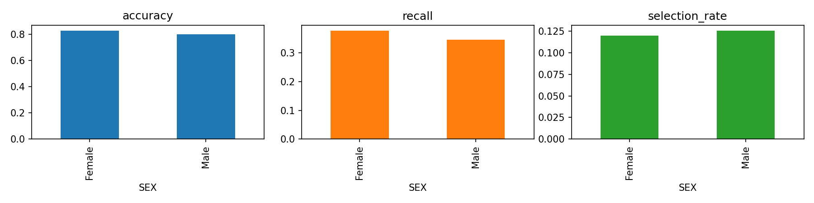
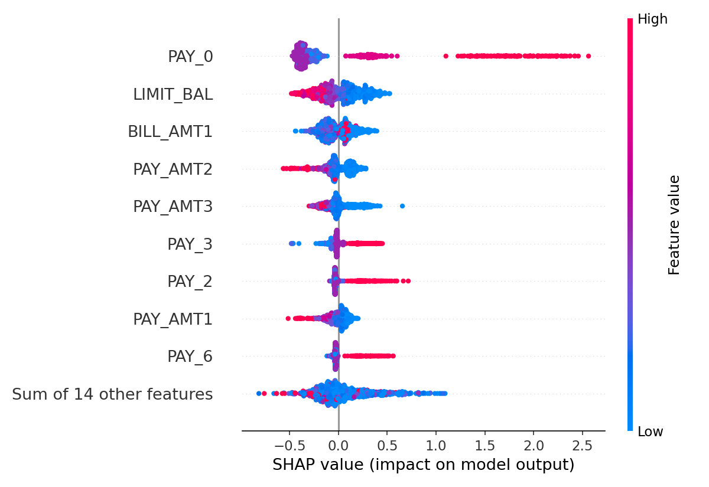

# Mini Responsible AI Audit — Credit Default Model

An audit of a credit-default classifier for fairness, explainability and
governance readiness, documented in the spirit of ISO/IEC 42001.

**Key finding:** the model shows no meaningful gender disparity, but it
detects only 36% of actual defaults. Its main risk is performance, not
group fairness.

## Model card

**Model:** HistGradientBoostingClassifier (scikit-learn), trained 1 November 2026
**Author:** Dr. Lineth Rodríguez

### Intended use
- Educational demonstration of a responsible AI audit
- Out of scope: any real credit decision about people

### Data
UCI Default of Credit Card Clients (Taiwan, 2005; Yeh & Lien, 2009):
30,000 clients, 23 features, binary target (default next month).
22.1% of clients defaulted, so classes are imbalanced.
Train/test split: 70/30, stratified (test set: 9,000 clients).

### Performance (test set)
| Metric | Value |
|---|---|
| Accuracy | 0.818 |
| ROC AUC | 0.777 |
| Recall (defaults detected) | 0.364 |
| Precision (defaults) | 0.66 |

Accuracy looks high mainly because most clients (78%) do not default.
When the model predicts a default it is right 66% of the time, but it
detects only 36% of actual defaults. Recall is the more relevant metric here.

### Fairness (sensitive attribute: gender)
| Group | Accuracy | Recall | Selection rate |
|---|---|---|---|
| Female | 0.829 | 0.378 | 0.120 |
| Male | 0.801 | 0.346 | 0.126 |

- Demographic parity difference: **0.006** (well below the common 0.1 threshold)
- Equalized odds difference: **0.032**

Selection rates are almost identical across genders. Recall is slightly
lower for men, so the model misses somewhat more actual defaults among
male clients.

### Explainability
The model relies mainly on recent repayment behaviour (**PAY_0**), credit
limit (**LIMIT_BAL**) and recent payment amounts (**BILL_AMT1**, **PAY_AMT2**).
A late payment last month is by far the strongest signal of default; higher
credit limits and larger payments lower the predicted risk.
**SEX does not appear among the top 9 features.**

**Proxy check:** average credit limit is similar across genders
(Female: 170,086 NT$; Male: 163,520 NT$, about 4% difference), so
LIMIT_BAL is unlikely to act as a strong gender proxy.

### Risks and mitigations
| Risk | Impact | Mitigation |
|---|---|---|
| Low recall: missed defaults | Financial loss for the lender | Threshold tuning, cost-sensitive training |
| Proxy bias via correlated features | Unfair treatment of a group | Proxy analysis, ongoing fairness monitoring |
| Outdated data (2005) | Degraded performance today | Retraining on recent data, drift monitoring |
| Opaque decisions | Clients cannot understand or contest outcomes | Per-decision SHAP explanations, human review |

### Regulatory context
- **EU AI Act:** evaluating the creditworthiness of natural persons is a
  high-risk use case (Annex III). It requires risk management, data
  governance, technical documentation, human oversight and transparency.
- **ISO/IEC 42001:** this card supports the documentation, impact
  assessment and monitoring practices expected within an AI management
  system. It is one input to compliance, not compliance itself.

### Limitations
- Only one sensitive attribute (gender) assessed; age, education and
  marital status not audited
- Proxy check compared averages only, not full distributions
- Historical data from one country and period
- No deployment, robustness or drift testing

## How to run
Open `mini_responsible_ai_audit.ipynb` in Google Colab and run all cells.

## Reference
Yeh, I. C., & Lien, C. H. (2009). The comparisons of data mining techniques
for the predictive accuracy of probability of default of credit card
clients. *Expert Systems with Applications*, 36(2), 2473–2480.
